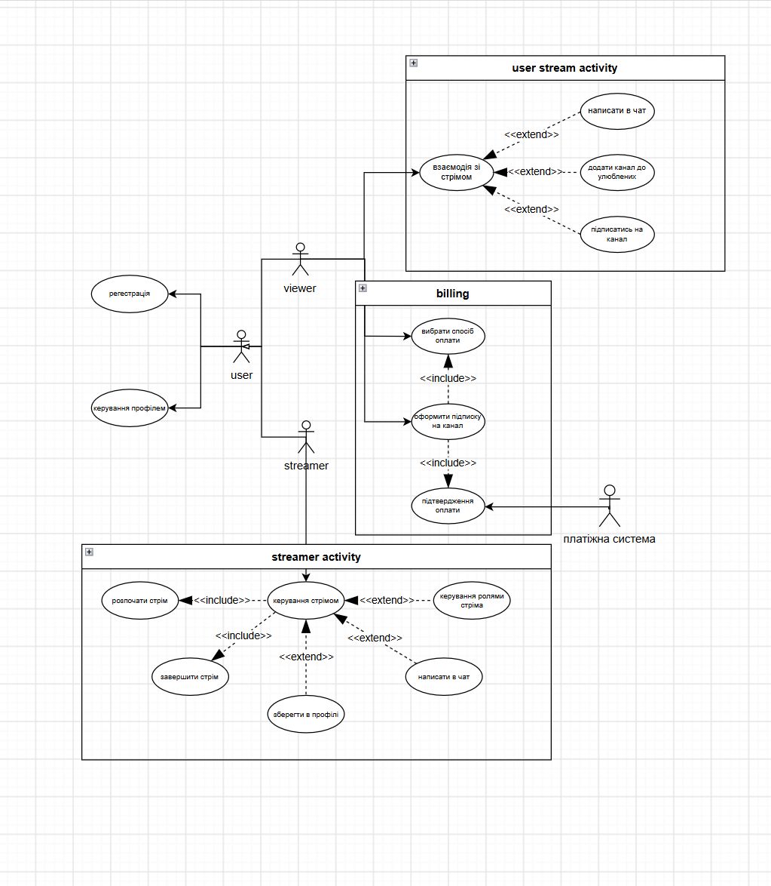

##Декларативний синтаксис діаграми use case

flowchart TD
%% Актори
user(["👤 user"])
viewer(["👤 viewer"])
streamer(["👤 streamer"])
payment_system(["👤 платіжна система"])

    %% Наслідування акторів для flowchart (використовуємо звичайну стрілку або пунктир з трикутником)
    viewer -->|узагальнення| user
    streamer -->|узагальнення| user

    %% Загальні прецеденти для користувача
    user --> reg("реєстрація")
    user --> prof("керування профілем")

    %% Взаємодія глядача зі стрімом
    viewer --> interact("взаємодія зі стрімом")
    subgraph user_stream_activity ["user stream activity"]
        chat_u("написати в чат") -.->|extend| interact
        fav("додати канал до улюблених") -.->|extend| interact
        sub_ch("підписатись на канал") -.->|extend| interact
    end

    %% Білінг
    viewer --> sub_pay("оформити підписку на канал")
    viewer --> pay_method("вибрати спосіб оплати")
    payment_system --> pay_conf("підтвердження оплати")

    subgraph billing ["billing"]
        sub_pay -.->|include| pay_method
        sub_pay -.->|include| pay_conf
    end

    %% Діяльність стрімера
    streamer --> manage_stream("керування стрімом")
    subgraph streamer_activity ["streamer activity"]
        manage_stream --> start_stream("розпочати стрім")
        manage_stream --> end_stream("завершити стрім")

        save_prof("зберегти в профілі") -.->|extend| manage_stream
        chat_s("написати в чат") -.->|extend| manage_stream
        roles("керування ролями стріма") -.->|extend| manage_stream
    end

## рендер відповідної діаграми виконаний в draw.io

