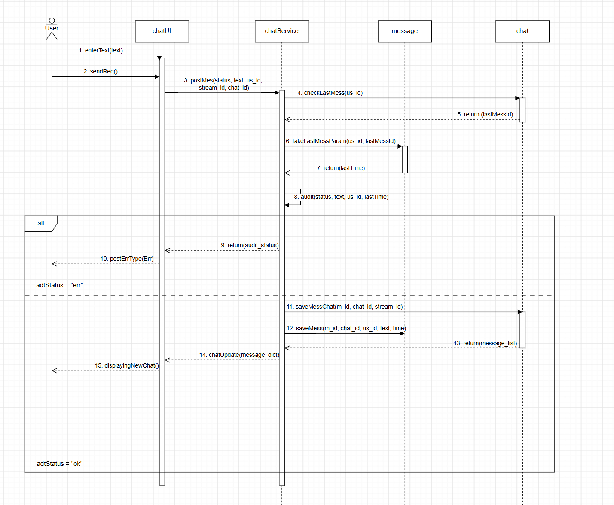

# розглянуті UC - користування чатом

## UC-1 : користувач вирішив написати повідомлення в чаті трансляції

учасники :

- user
- charUI
- chatService
- message
- chat

Кроки:

1. enterText(text): написання повідомлення
2. sendReq(): натискання кнопки надіслати
3. postMes(status, text, us_id, stream_id, chat_id): запит на сервіс для обробки запиту надсилання повідомлення
4. checkLastMess(us_id): запит на отримання id останнього повідомлення користувача
5. return (lastMessId): повернення id останнього повідомлення користувача сервісу
6. takeLastMessParam(us_id, lastMessId) запит на отримання часу коли останнє повідомлення було записано
7. return(lastTime) отримання цього часу сервісом
8. audit(status, text, us_id, lastTime) перевірка на відповідність всім вимогам для надсилання повідомлення

ALT
auditstatus = err: (9-10)

9. return(audit_status): повернення статусу перевірки
10. postErrType(Err) відобарженя помилки із збереженим текстом та часом що залишилось почекати

auditstatus = ok:(9-12)

11. saveMessChat(m_id, chat_id, stream_id): збереження подомлення в таблиці chat на каналі
12. saveMess(m_id, chat_id, us_id, text, time): збереження повідомлення в таблиці message
13. return(message_list): отримання оновленої історії
14. chatUpdate(message_dict): оновлення історії з всіма атрибутами
15. displayingNewChat(): відображення оновленого чату

## US-2: відправка відповіді користувачем в чаті на бажане повідомленн

учасники:

- user
- charUI
- chatServis

кроки:

loop(1-2)

1. enterText(text): позначення повідомлення адресата
2. sendReq(): зміна типу повідомлення з вказаним параметром "адресата"
3. postMes(status, text, us_id, stream_id, chat_id): введення тексту
4. checkLastMess(us_id): запит на відправку повідомлення з його параметрами
5. return (lastMessId): перевірка повідомленням на вимоги
6. takeLastMessParam(us_id, lastMessId)
7. return(lastTime)
8. audit(status, text, us_id, lastTime)

ALT
status = err: (9-10)

9. return(audit_status): повернення статусу перевірки
10. postErrType(Err) відобарженя помилки із збереженим текстом та часом що залишилось почекати

auditstatus = ok:(9-12)

11. saveMessChat(m_id, chat_id, stream_id): повернення статусу перевірки
12. saveMess(m_id, chat_id, us_id, text, time): збереження повідомлення в чаті
13. return(message_list): оновлення історії
14. chat update(message_dict): відображення оновленого чату
15. displaying new chat()

UC-3: видалення повідомлення користувачем з відповідним правом на трансляції (streamer, vip)

учасники:

- stremer/vip
- charUI
- chatServis

кроки:

1. виділення повідомлення
2. відобразити можливі дії
3. вибрати "delete"
4. перевірити статус повідомлення
5. повернення статусу перевірки
6. відправити запит на видалення з id повідомлення
7. оновлення історії
8. відображення історії
